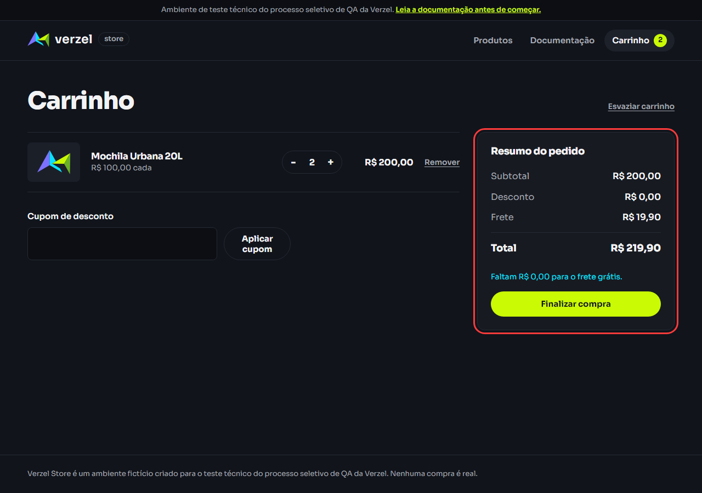

Validação da entrega **"Cupom de desconto e frete grátis"** (card VZS-142, v2.3.0) da [Verzel Store](https://verzel-store.qa-test-verzel-store.workers.dev), feita por **Brenda Beatriz Maciel da Silva** para o teste técnico de QA Júnior da Verzel.

## Resultado

| Cenários | Passou | Falhou | Bugs |
|:---:|:---:|:---:|:---:|
| **72** | **62** | **10** | **7** |

**Recomendação:** a entrega **não está pronta para produção**. Os bugs BUG-01 e BUG-02 violam critérios de aceite explícitos (CA06 e CA10).

| Critério de aceite | Resultado |
|---|---|
| CA01 a CA05: cupom | ✅ Passou |
| CA06: frete grátis a partir de R$ 200,00, inclusive | ❌ Falhou ([BUG-01](03-bugs.md#bug-01)) |
| CA07 a CA09: frete, valor faltante e desconto | ✅ Passou |
| CA10: máximo de 5 unidades na interface e na API | ❌ Falhou ([BUG-02](03-bugs.md#bug-02)) |
| CA11: arredondamento | ✅ Passou |

## Bugs encontrados

| Bug | Resumo | Severidade |
|---|---|---|
| [BUG-01](03-bugs.md#bug-01) | Subtotal de exatamente R$ 200,00 cobra frete de R$ 19,90, e a tela mostra "Faltam R$ 0,00" | 🔴 Alta |
| [BUG-02](03-bugs.md#bug-02) | A API aceita mais de 5 unidades por produto e confirma o pedido | 🔴 Alta |
| [BUG-03](03-bugs.md#bug-03) | Item sem `produtoId` retorna "Produto undefined não encontrado." | 🟡 Baixa |
| [BUG-04](03-bugs.md#bug-04) | Remover o último item mantém o cupom, que volta aplicado sozinho | 🟡 Baixa |
| [BUG-05](03-bugs.md#bug-05) | Nome só com números ("123 456") é aceito | 🟡 Baixa |
| [BUG-06](03-bugs.md#bug-06) | E-mail com pontos seguidos (`maria@exemplo..com`) é aceito | 🟡 Baixa |
| [BUG-07](03-bugs.md#bug-07) | No celular, os links "Produtos" e "Documentação" somem do menu | 🟡 Baixa |



## Documentos

| | Documento | Conteúdo |
|---|---|---|
| 📋 | [Relatório de execução](02-execucao.md) | Resultado dos 51 cenários dos critérios de aceite, sessões exploratórias e interpretações de ambiguidades |
| 🔎 | [Testes complementares](05-testes-complementares.md) | 21 cenários além do exigido: navegação, celular, Firefox/Safari, teclado |
| 🐞 | [Bugs](03-bugs.md) | Os 7 bugs com passos, esperado x obtido, análise e evidências |
| 📸 | [Evidências](04-evidencias.md) | 47 screenshots organizados por cenário |
| 🧾 | [Log da API](evidencias/api-log.md) | Requisição e resposta de cada chamada de API |
| 🎭 | [Relatório do Playwright](relatorio-playwright/index.html) | Resultado interativo dos 46 testes automatizados, com screenshot de cada um |
| 📮 | [Coleção Postman](postman/) | 37 requisições com 123 verificações ([baixar a coleção](postman/verzel-store.postman_collection.json)) |
| 🥒 | [Cenários em Gherkin](https://github.com/Brwnds/verzel-store-qa/tree/main/docs/01-cenarios) | 72 cenários em 8 arquivos `.feature` |

## Como rodar a automação

```bash
npm install
npx playwright install chromium
npm test               # 46 testes Playwright (UI + API)
npm run test:postman   # coleção Postman via Newman
```

O passo a passo completo e as decisões da automação estão no [README do repositório](https://github.com/Brwnds/verzel-store-qa#readme).
